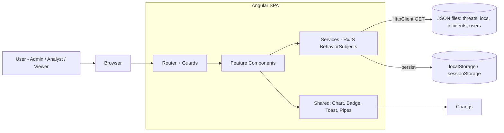
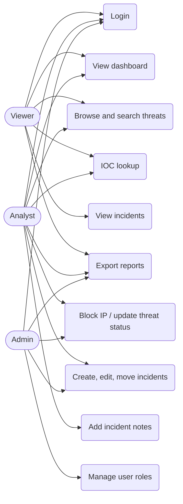
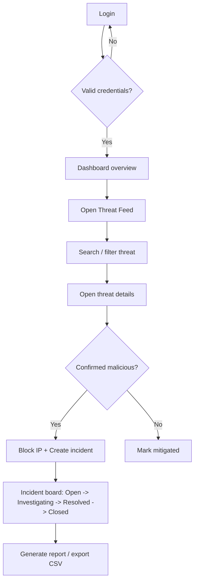
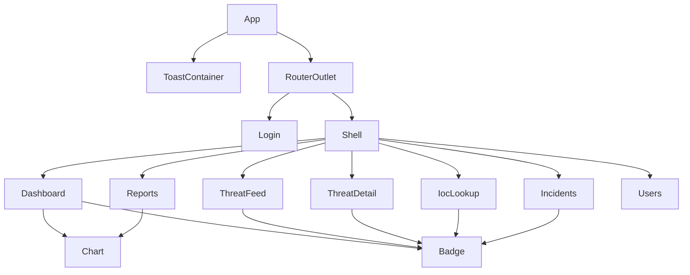
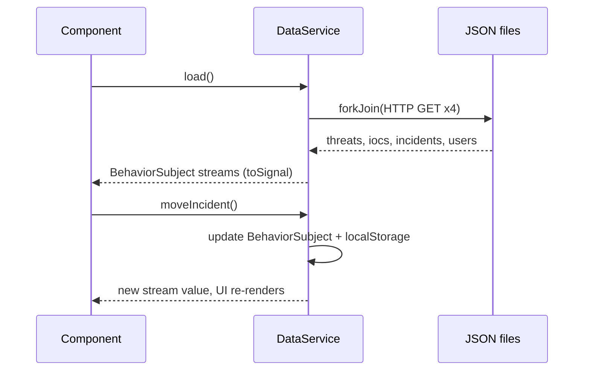

# Architecture & Design Diagrams (Mermaid)

Render these in VS Code (Mermaid preview), GitHub, or https://mermaid.live and export as PNG for the report.

## 1. System Architecture

## 2. Use-Case Diagram

## 3. Workflow

## 4. Component Hierarchy

## 5. Data Flow (RxJS)

